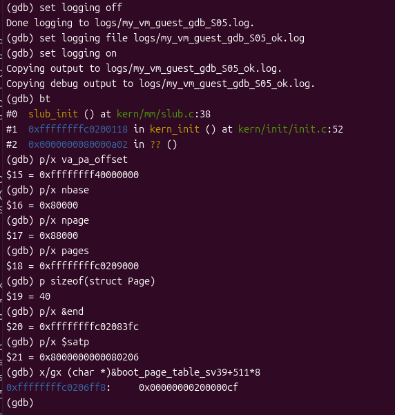

# Lab2 物理内存和页表实验报告

## 一 实验信息与完成情况

| 项目 | 内容 |
|---|---|
| 实验名称 | Lab2 物理内存和页表 |
| 成员一 | 石昊洋，2411804；物理内存初始化、QEMU/GDB 与 TLB 调试、内存探测思考题 |
| 成员二 | 邹俊轩，2412592；First-Fit 分析、Best-Fit、简化 SLUB、实验报告整理 |
| 成员三 | 秦东杰，2411738；Buddy System、独立 Buddy/SLUB 测试、集成验收 |
| 代码仓库 | https://github.com/shangyang61/10-OS2026 |
| 实现基线 | `27a9202e66fbbec859b06c7b3054afa4fb6558f4`，已合入成员三成果 |
| 报告整理日期 | 2026-10-24 |

我们已经完成物理页初始化、First-Fit 分析与修复、Best-Fit、Buddy System、简化 SLUB，以及独立测试和集成验证。默认 Best-Fit 路径在课程 QEMU 4.1.1 中评分为 20/20；Buddy 六组独立测试与 SLUB 八组独立测试通过，SLUB 在 Best-Fit 和 Buddy 两种页策略下均完成验证。

本文依据各成员提交的源码、规格、提示词和原始日志整理。成员一的地址翻译调试、成员二的 WSL 验证和成员三的 VMware 集成验证属于不同运行，分别注明环境和地址，不能相互替代。正文和日志已经齐备；S01～S08 为待补的实际截图位置，操作见[截图操作指南](截图操作指南.md)。课程平台提交另按实际操作完成，不在报告中预写为已提交。

## 二 实验整体逻辑与环境

### 2.1 从启动到对象分配

本实验围绕两个问题展开：一是哪些物理页可以交给内核使用，二是如何按不同粒度分配这些页。地址翻译负责把虚拟地址转换为物理地址，页分配器负责页的所有权与空闲状态，SLUB 再把页拆成供小对象使用的槽位。

```text
OpenSBI 传入 Hart ID 和设备树地址
  → entry.S 建立启动根页表、设置 satp、切换高地址与启动栈
  → kern_init 清 BSS，dtb_init 读取 RAM，初始化控制台
  → pmm_init
      → init_pmm_manager 选择 Best-Fit 或 Buddy 并初始化内部结构
      → page_init 布置 Page 数组、保留占用区、登记完整空闲页
      → pmm_manager->check 检查当前页分配器
  → Best-Fit 配置运行 member2_page_check
  → slub_init、slub_check
  → MEMBER3_TESTS=1 时运行独立测试
      → Buddy 配置：member3_buddy_test
      → 两种配置：member3_slub_test
  → while (1)
```

page_init 执行时 Sv39 已开启，它初始化的是物理页管理状态。申请物理页不会自动为任意虚拟地址建立页表项；本实验通过已有内核直接映射访问页数据。

### 2.2 三组证据的环境

| 项目 | 成员一初始化与调试 | 成员二开发验证 | 成员三最终集成验证 |
|---|---|---|---|
| 系统标识 | VMware `os2026` | WSL2 Ubuntu-22.04 | VMware `monstern-VMware-Virtual-Platform` |
| Linux 内核 | 7.0.0-38-generic | 带 microsoft-standard-WSL2 标识 | 7.0.0-38-generic |
| RISC-V GCC | SiFive 10.2.0 | 15.1.0 | 14.2.0 |
| QEMU | 4.1.1，含源码调试信息 | 7.0.0 | 4.1.1 |
| OpenSBI 串口版本 | v0.4 | v1.0 | v0.6 |
| RAM | 128 MiB | 128 MiB | 128 MiB |
| 启动配置 | 课程 loader | portable | 课程 loader |
| 原始证据 | `logs/os2026_*` | `logs/member2_wsl_128M_*` | `logs/member3_vm_*`、`member3_bestfit_128M_*` |

成员三 QEMU 路径为 `/opt/ucore-manual/qemu-4.1.1/bin/qemu-system-riscv64`，编译器为 `/usr/bin/riscv64-unknown-elf-gcc`。具体版本、时间与系统标识见[成员三集成环境](logs/member3_vm_environment.json)和[Best-Fit 回归环境](logs/member3_bestfit_128M_environment.json)。本机存在 VMware 并不说明其中已经配置了相同工具，复验前需核对路径。

**待补截图 S01：** 同一终端显示实验目录、Git 提交、uname、交叉编译器与 QEMU 版本。操作见截图指南 S01。

```markdown

```

### 2.3 构建参数与两种启动方式

`PMM=best_fit` 为默认值，`PMM=buddy` 选择 Buddy；`MEMBER3_TESTS=1` 打开成员三独立测试；`PORTABLE_BOOT=0` 为课程默认启动，`PORTABLE_BOOT=1` 用于现代固件。三者都是编译参数，手动切换前执行 make clean，并在 build 与 qemu 两个命令中使用同一套参数。

课程配置使用 loader 把镜像放在 0x80200000，根表仅第 511 项有效。portable 配置改用 -kernel，并在根表索引 2 加入启动过渡同址映射，供写 satp 后跳转高地址之前取指使用。成员二曾分别构建两套镜像，检查根项为 `{511}` 与 `{2,511}`，见[检查记录](logs/member2_boot_profiles.json)；其中镜像摘要属于当时构建，不冒充新增 Buddy 后的镜像摘要。

## 三 物理内存初始化

### 3.1 规格如何制定

page_init 的输入来自设备树中的内存起址、长度和链接符号 end，输出为 va_pa_offset、npage、pages，以及分配器的初始空闲区。我们先明确地址单位，再把占用区保护、整页对齐和异常处理写成规格：

1. 设备树起址和长度不得缺失，求和前检查溢出，RAM 必须覆盖本框架 DRAM 基址和内核。
2. 管理末端取设备树末端与 PHYSICAL_MEMORY_END 的较小值，再向下按 4096 B 对齐。
3. npage 是管理末端的绝对物理页号，描述符数量为 npage-nbase。
4. 描述符数组位于内核末端向上对齐之后，写入前确认完整数组位于可管理 RAM 中。
5. 先把所有 Page 置为 Reserved，再将元数据之后的完整空闲页交给 init_memmap。
6. 无完整空闲页时不调用 init_memmap(base,0)；无效布局调用 panic。

这使固件所在低地址保留区、内核和描述符自身不会被误分配。当前实现按单段 DRAM 与固定 nbase 管理，没有实现通用的多段 RAM、设备树全部 reserved-memory 与热插拔处理。

### 3.2 四种地址量

end 是内核虚拟地址，设备树给出物理地址；Page 指针是元数据地址，不是所管理页的数据地址。转换关系为：

```c
page2ppn(p) = p - pages + nbase;
page2pa(p)  = page2ppn(p) << PGSHIFT;
pa2page(pa) = &pages[PPN(pa) - nbase];
```

本实验 RAM 为 `[0x80000000,0x88000000)`，nbase=0x80000、npage=0x88000，因此有 32768 个描述符。该数量包含保留页，不等于可分配页数。PADDR 只适用于本实验的内核直接映射，不能用固定偏移处理任意进程地址。

### 3.3 当前集成版本的布局

按日志中的 end、4096 B 页和 RV64 的 sizeof(Page)=40 计算，描述符总大小为 `32768×40=0x140000` B。下表前两列来自成员三开启独立测试的运行，第三列为成员一旧验证内核。

| 项目 | Buddy 集成配置 | Best-Fit 集成配置 | 成员一旧验证内核 |
|---|---|---|---|
| end 虚拟地址 | `0xffffffffc020b63c` | `0xffffffffc020a2fc` | `0xffffffffc0206078` |
| Page 数组起点 PA | `0x8020c000` | `0x8020b000` | `0x80207000` |
| 空闲区起点 PA | `0x8034c000` | `0x8034b000` | `0x80347000` |
| 初始可分配页数 | **31924** | **31925** | **31929** |
| 启动根表 PA | `0x80208000` | `0x80207000` | `0x80205000` |

例如 Buddy 空闲页数为 `(0x88000000-0x8034c000)/4096=31924`，与其 T2、SLUB T8 日志一致。代码、静态测试数组和编译参数会改变 end，因此不能沿用旧文档中的 0x8038c000 或 31796，也不能要求不同配置具有完全相同的空闲页数。当前两套布局分别见[Buddy 日志](logs/member3_vm_buddy_qemu.log)和[Best-Fit 日志](logs/member3_vm_best_fit_qemu.log)。

**待补截图 S05：** 在内核 GDB 中观察初始化后的 pages、npage、nbase、sizeof(Page)、end 与 satp，并按该次构建重新计算空闲区。不能在 page_init 尚未执行完时读取这些变量作为最终结果。

```markdown

```

## 四 First-Fit 分析与改进

### 4.1 四个核心函数

default_init 初始化链表哨兵和 nr_free=0。default_init_memmap 接收合法连续页区间，解除 Reserved、清旧状态，在块首记录页数 property 并按地址插入链表；一个空闲块只占一个链表节点。

default_alloc_pages(n) 从低地址起寻找首个 property≥n 的块。选中 m 页后交付前 n 页；若 m>n，把 base+n 登记为 m-n 页余块，保持地址顺序。nr_free 只减少实际交付的 n 页，已分配块首清除 Property。

default_free_pages(base,n) 重设描述符、登记新块并增加 n 页，再按地址插回。若前块末端等于 base，就先向前合并并更新 base；再比较合并后的末端与后块起点。链表相邻不等于物理相邻，必须核对区间端点。合并只改元数据，不搬移页数据，也不重复增加 nr_free。

### 4.2 实际修复与改进空间

原框架的登记和释放函数有两处尾插后未退出循环，会再次访问刚插入的节点并把节点插入自己之后，破坏 prev/next。两处增加 break 后，新增双向链接检查通过。受控副本撤销修复时，原始 check_alloc_page 已成功，仍能触发 `list_next(le)->prev == le` 断言，见[旧缺陷复现](logs/member2_first_fit_defect_portable_qemu.log)；修复后课程环境回归见[First-Fit 日志](logs/member3_bestfit_128M_first_fit_qemu.log)。

若空闲块数为 F，搜索最坏 O(F)，释放还需重设 n 个描述符，成本为 O(n+F)。可用 Next-Fit 改变起点，或增加分桶、平衡树等索引减少扫描；这些方法增加维护成本，也不保证碎片一定更少。还可加强区间重叠检查和并发保护。当前接口要求调用者释放合法拥有的范围，Property 不是每页独立的“已分配位”。

## 五 Best-Fit 实现

### 5.1 规格与选择策略

Best-Fit 实现 pmm_manager 的 init、init_memmap、alloc_pages、free_pages、nr_free_pages、check 六个方法。规格要求选最小充分块、同长取低地址、分割保留余块、回收双侧合并，失败不改动状态；同时保留原始 basic_check 和 best_fit_check。完整约束见[成员二规格](specs/member2.md)。

地址排序用于找到物理邻居，大小比较用于选择候选，两者职责不同。例如地址顺序的空闲块为 8、5、12 页，请求 4 页时 First-Fit 选 8 页，Best-Fit 扫描后选 5 页，分别留下 4 页与 1 页。

### 5.2 核心函数与接入

best_fit_init 初始化 free_area；best_fit_init_memmap 解除合法区间的保留状态，建立块首后交给 best_fit_insert。best_fit_alloc_pages 遍历所有足够大的块，保存最小候选；地址有序遍历使同长候选保留低地址。exact fit 已不能改善，可提前停止。

选中块后从链表摘除，交付前 n 页，余块保留在原位置；nr_free 减 n。best_fit_free_pages 重设被归还的描述符、增加 n 页，再按地址插入，合并前后物理邻居。best_fit_insert 也用于初始化登记，因而能处理多次登记的相邻区间。

当前默认编译定义为 USE_BEST_FIT_PMM，init_pmm_manager 真正注册 best_fit_pmm_manager；原测试保持不变，并由[五函数保护清单](specs/protected_functions.json)核对。

### 5.3 不变量和进一步改进

链表只含空闲块首，区间地址有序、不重叠，块长总和等于 nr_free；拆分不能丢余块，合并要删除旧块首并清其标志。总空闲页数够用也可能没有足够大的连续块，这时必须返回 NULL。

申请最坏 O(F)，释放 O(n+F)。可保留地址索引并增加按 `(块长,地址)` 排序的树，用 lower_bound 查找最小充分块，但拆分、合并时需同步维护两套索引，逐页状态更新成本也仍然存在。Best-Fit 只最小化当前剩余量，不知道未来请求，可能积累难用的小块，并非整个请求序列的全局最优。

## 六 Buddy System 实现

### 6.1 规格与按阶组织

Buddy 以 order 0～15 的 16 条空闲链表管理 2^order 页块；块首物理页号按块大小对齐。buddy_init_memmap 将任意起点、任意长度的空闲区拆成既能放入剩余区间、又满足起点对齐的最大二次幂块，再逐块登记。不能假设 page_init 交出的起点已经按大块对齐。

buddy_order_of(n) 求最小 k，使 2^k≥n；超出支持阶时返回饱和值，避免极大请求移位或循环溢出。buddy_alloc_pages 从 need 阶向上找空闲块，逐级二分并把上半块放回，最终交付低半块。

伙伴通过描述符索引 `index XOR (1<<order)` 查找，先检查管理边界，再要求对方是同阶空闲块首。本框架 nbase=0x80000 对当前各阶充分对齐，索引计算与物理页号的伙伴关系一致；扩展到不同基址或多个 zone 时必须重新明确对齐基准和边界。

### 6.2 真实阶数与 SLUB 契约

```text
alloc_pages(3)      → order=2，实际占 4 页，块首 property 记录 2
free_pages(base,3)  → 从块首读回 order=2，完整归还 4 页
```

SLUB 保存的是请求页数，Buddy 保存真实阶数，因此不用改 slub.c 也能完整归还大对象使用的页。buddy_free_pages 先校验块首状态和请求对应的阶，再重设整个块并合并；buddy_insert 只在合并前增加本次归还块的页数，伙伴原本已计数，不能再按合并后大小重复累加。

合法调用要求传回原块首及原请求。当前断言检查的是请求是否落在同一阶的范围，并未保存原始 n，不能识别“误传了同阶的另一个请求页数”。不能据此声称任意错误释放都可检测或恢复，也不支持将大块的一部分单独释放。

### 6.3 成本、碎片与接入

若实际分配 A=2^k 页，则 n≤A<2n，额外页数 A-n<n。这是按阶取整造成的内部余量。Best-Fit 在页数接口层面精确交付 n 页，但两者都仍有 4 KiB 页粒度和对象层带来的取整成本。

查阶、拆分和逐级合并最多经过 H=16 个阶；本实现还逐页清状态，所以分配和释放总成本应写为 O(H+A)，不能把整个 C 函数笼统写成只有 O(log N)。

`PMM=buddy` 定义 USE_BUDDY_PMM。Buddy 配置不运行断言 Best-Fit 具体地址的 member2_page_check；slub_check 的 OOM 构造改为逐页申请；独立测试由 MEMBER3_TESTS 开关接入。完整规格见[成员三规格](specs/member3.md)。

## 七 简化 SLUB 的两层结构

### 7.1 接口规格与元数据

底层通过 alloc_pages/free_pages 取得连续页，上层用 kmalloc/kfree 分配对象。小对象使用 16、32、64、128、256、512、1024、2048 B 八个规格，每个 slab 一页。页头记录魔数、规格号、capacity、inuse、页数、freelist、链表节点与位图，头部按 16 B 对齐。

容量按 `(4096-header_size)/stride` 计算，不能直接用 4096/stride。当前 RV64 页头为 96 B，16 B 规格可放 250 个对象，2048 B 规格一页只能放一个对象；页头开销不能省略。测试中的关键行为尽量不依赖该内部布局。

slub_init 在 pmm_init 成功后执行一次；kmalloc(0) 返回 NULL，kfree(NULL) 无操作，OOM 返回 NULL，返回地址按 16 B 对齐，内容不保证清零。

### 7.2 空闲槽与状态转换

空闲槽位的前几个字节保存下一槽位指针。分配时弹出 freelist、更新位图和 inuse；对象交给调用者后，这些字节可以被正常业务数据覆盖。释放后对象重新属于分配器，调用者不能继续读写。

只有未满 slab 在 partial 链表。满页移出，full 页释放一个对象后重新入链；最后一个对象被释放时删除页记录并把整页归还底层。释放单个对象不一定增加 nr_free_pages，只有空页回收到页层后才增加。

### 7.3 大对象与边界

大于 2048 B 的请求取得 `ceil((size+header_size)/4096)` 页，在头部记录请求页数。4096 B 对象加上页头后需要两页；在 Buddy 下请求页数还可能提升为更大的二次幂块，按上一节的真实阶数契约归还。

在长度加头部和舍入余量之前检查溢出，页分配失败不写 NULL。小对象释放检查魔数、规格号、槽位边界和位图。这些是有限诊断，不能保证野指针、重复释放或释放后访问安全。当前没有锁、每 CPU 缓存、NUMA、构造器和压力回收；立即归还空页便于核对恢复，但频繁申请释放可能增加底层调用成本。

## 八 Sv39 地址翻译和 TLB 调试

### 8.1 页表不是页分配器

Sv39 使用三级索引，每级 9 位、页内偏移 12 位，页表项为 8 B。satp.MODE=8 表示 Sv39，PPN 字段给出根表物理页号。R/W/X 全零的有效项指向下级表；具有合法访问许可的项可成为叶子，仍需检查权限和大页对齐。三级结构表示最多三级，本实验启动映射在根级就是 1 GiB 叶子。

当前课程根表第 511 项为 0x200000cf，包含 V/R/W/X/A/D 标志，PPN=0x80000。映射把高地址根区对应到物理 0x80000000 起的区域；实际 RAM 管理仍受 128 MiB 上界和保留区约束，映射跨度不是可分配 RAM 大小。

### 8.2 两个 GDB 的分工

RISC-V GDB 连接 QEMU gdb stub，观察客体指令、satp、Page 数组和内核符号；主机 x86_64 GDB 调试 QEMU 进程，观察 get_physical_address、页表读取和软件 TLB。二者暂停的是不同层次；主机停住时客体 GDB 的远程请求可能等待。

成员一的[内核日志](logs/os2026_guest_gdb.log)和[QEMU 日志](logs/os2026_host_gdb.log)记录了以下旧内核现场，不能直接当作新增 Buddy 后的地址：

| 观察量 | 成员一实际记录 |
|---|---|
| 取指 VA | `0xffffffffc02000d8` |
| satp | `0x8000000000080205` |
| 根表 PA | `0x80205000` |
| 根索引 | 511 |
| PTE 地址 | `0x80205000+511×8=0x80205ff8` |
| PTE | `0x200000cf` |
| 查询循环 | i=0、levels=3、ptshift=18，在首轮遇到叶子 |
| 输出物理页基址 | `0x80200000` |
| 完整 PA | `0x80200000+0xd8=0x802000d8` |

QEMU 该路径给出的是目标 4 KiB 页的物理基址，完整地址还要加低 12 位偏移。根级大页计算保留对应低 30 位，不能把该次查询描述成真正读取了三级页表。源码参照 [QEMU 4.1.1 MMU](https://github.com/qemu/qemu/blob/v4.1.1/target/riscv/cpu_helper.c)，实际调试仍以成员一源码和日志为准。

**待补截图 S06：** 主机 GDB 显示实际访问类型、调用栈、addr、satp、根表、PTE 与计算结果，截图前排除由调试器读内存触发的查询。

```markdown

```

### 8.3 TLB 缺失 填充和命中

成员一记录的取指路径为 `get_page_addr_code → tlb_fill → riscv_cpu_tlb_fill → get_physical_address → tlb_set_page → tlb_set_page_with_attrs`。首次查询的 addr_code 为全 1，目标页未匹配；填充把 VA 页 0xffffffffc0200000 映射到 PA 页 0x80200000。后续该页的 addr_code 为 0xffffffffc0200000，符合命中条件。

这与 [QEMU 4.1.1 软件 TLB 查询源码](https://github.com/qemu/qemu/blob/v4.1.1/accel/tcg/cputlb.c)的查表、慢路径填充流程一致。TCG 有生成的快路径，取指还可能复用已翻译执行块，不能要求每次访存都进入同一个 C helper。优化导致数据读局部变量 optimized out 时，保留原始记录，不补写无法观察的值。

**待补截图 S07：** 同一次访问的 miss 与 fill，显示目标地址、旧 addr_code、翻译/填充调用栈和安装的 VA/PA。

```markdown

```

**待补截图 S08：** 同一目标页后续 addr_code 匹配，配合实际分支或单步证据说明命中。只看到进程继续运行不足以证明命中。

```markdown

```

### 8.4 Bare 与硬件 TLB 的区别

成员一还观察到 satp=0 时 VA=PA=0x80200000 的软件 TLB 填充。Bare 关闭客体分页，不意味着 QEMU 不再缓存客体访问到宿主内存的关系。真实 CPU TLB 是硬件地址翻译缓存，QEMU soft TLB 是服务模拟执行的数据结构，二者不能逐项等同。数据写入路径也已记录到 store_helper、tlb_fill 和 get_physical_address，详见原始主机调试日志。

## 九 规格与提示词的编写

我们先把每个任务写成“输入与输出、状态不变量、合法调用范围、失败行为、验收判据”，再把这些内容转成提示词。初始化强调地址单位和保留区；Best-Fit 强调框架兼容与不改测试；Buddy 强调对齐、真实阶数和释放契约；SLUB 强调两层结构与对象生命周期。测试提示词单独规定能发现哪些错误，避免只让实现者重复描述自己的代码。

下文完整收录交付材料中的提示词。page_init、Best-Fit 和 SLUB 实现提示词为各成员整理的可复现版本，不冒充历史对话逐字导出；Buddy 与独立测试提示词对应成员三提交的三份文件。实现与测试的主体内容分别保留，报告中不以一句“已使用 AI”代替。

### 9.1 page_init 实现提示词

来源：[reports/成员一实验报告.md](reports/成员一实验报告.md)。

```text
请阅读当前 lab2 的 kern/mm/pmm.c、pmm.h、memlayout.h、mmu.h、
kern/driver/dtb.c、default_pmm.c 和 tools/test_lab2.c，
仅实现 //lab2 function1 标记处的 static void page_init(void)。

保持实验现有物理内存管理接口，不实现或修改 Best-Fit、Buddy 和 SLUB。
设置 va_pa_offset，读取设备树内存起址和大小，验证缺失信息和地址求和溢出。
必须区分内核虚拟地址、物理地址、物理页号和 Page 描述符地址。
可管理上界不能超过 PHYSICAL_MEMORY_END，向下按 PGSIZE 对齐。
npage 必须使用可管理末端的绝对物理页号，描述符数量为 npage-nbase。
将 pages 放在链接符号 end 之后并按页对齐；写数组前检查容量。
先把全部 Page 标为 reserved，再登记描述符数组末端之后的完整空闲页。
保证 OpenSBI、内核和描述符数组占用空间不会进入空闲区。
没有完整空闲页面时，不得调用 init_memmap(base,0)。
无效设备树和无法容纳描述符时调用 panic。
保留 lab2 注释，将本任务 YOUR CODE 替换成 2411804。
解释每个地址计算式，并检查 tools/test_lab2.c 的初始化检查约定。
```

### 9.2 page_init 边界测试提示词

来源：[reports/成员一实验报告.md](reports/成员一实验报告.md)。

```text
请对最终 page_init 实现设计测试。先在 os2026 中运行真实 RISC-V 内核，
调用原框架 test_page_init 并保留串口日志，再验证默认分配器自检。
另外提取最终 C 函数体，在隔离的模拟物理内存中测试：正常范围、
未对齐尾页、管理上限截断、起址为零、长度为零、求和溢出、
DRAM 起点不匹配、内核超出内存、描述符放不下和无完整空闲页。
测试实际 C 代码，不只重写一遍计算公式；模拟环境测试与内核实测须分开标注。
```

### 9.3 Best-Fit 实现与接入提示词

来源：[prompt.md](prompt.md)。

```text
阅读成员一交付中的 pmm.c、pmm.h、memlayout.h、default_pmm.c、
best_fit_pmm.c 和 libs/list.h。在 lab2 function2-2 标记处完成 Best-Fit。
保留成员一 page_init 函数体与其署名，不用旧参考版本替换。
保持 basic_check 和 best_fit_check 完全不变，兼容 free_list/nr_free 约定。
实现 init、init_memmap、alloc_pages、free_pages、nr_free_pages 和 manager。
链表按地址排序；申请选最小充分块，同长取低地址，exact fit 可停止。
分割保留剩余块；回收先前后后合并并维护头指针、标志和总页数。
在 pmm.c 真正选用 best_fit_pmm_manager。
解释不变量、First-Fit 对比、复杂度和可能改进。
运行真实 RISC-V 内核、原始评分与额外边界检查，不改测试绕过失败。
本人学号必须来自用户确认，不能挪用成员一学号。
```

### 9.4 SLUB 实现提示词

来源：[prompt.md](prompt.md)。

```text
基于已有页接口实现简化 SLUB，提供 slub_init/kmalloc/kfree。
16 至 2048 共八个大小类，每个 slab 一页，元数据位于页内头部。
用空闲槽位内嵌指针组成 freelist，位图记录槽位占用。
只将未满页加入 partial 链表，full 释放后重新加入，empty 立即还页。
大对象申请包含头部的连续多页并记下页数，注意溢出、OOM、0、NULL。
数据地址必须由物理页通过内核直接映射得到，不能写 Page 描述符。
不使用宿主机 malloc，不递归依赖 kmalloc 分配元数据。
在物理页管理成功初始化后接入，并明确只有单 hart 和16字节对齐。
配套自检覆盖规格边界、跨 slab、数据保持与不重叠、重用、页数恢复。
自检不冒充成员三的独立测试；保留真实编译和运行记录。
```

### 9.5 Buddy 实现提示词

来源：[prompts/member3/01_buddy_implementation_prompt.md](prompts/member3/01_buddy_implementation_prompt.md)。

```text
你要为这个 RISC-V ucore 实验实现一个 Buddy System 物理页分配器，并接入
kern/mm/pmm.h 里的 struct pmm_manager。先读 pmm.c、pmm.h、memlayout.h、
libs/list.h 和成员二写好的 best_fit_pmm.c。

必须满足的接口与不变量：

1. 提供 buddy_pmm_manager，实现 init、init_memmap、alloc_pages、
   free_pages、nr_free_pages、check 六个方法。
2. 空闲块按 order 分链表，第 k 条链只放 2^k 页的块，最多 MAX_ORDER 阶。
3. 只有块首页 set PG_property，property 记录该块的 order。非块首页清零。
4. 块首物理页号必须按 2^k 对齐，否则 pfn XOR (1<<k) 不能定位伙伴。
5. init_memmap 收到的是一段任意对齐、任意长度的连续空闲区，必须把它拆
   成若干按自身大小对齐的 2 的幂块，不能假设起点是大阶对齐的。
6. alloc_pages(n) 取 k = ceil(log2(n))，从最小可用阶找块，逐级二分，
   把上半块放回对应阶链表，返回低半块。返回块必须对齐且不和别人重叠。
7. free_pages(base,n) 必须能和合法的同阶空闲伙伴逐级合并；只有同阶、
   仍是空闲块首的伙伴才可合并，不能按"物理相邻"就合并。
8. 关键：alloc_pages(n) 在块首记录真实 order。free_pages(base,n) 用它
   恢复真实块大小，而不是只按调用者传的 n 去猜。原因是上层 SLUB 的大对象
   保存的是请求页数（例如 3 页），而实际拿到的是 4 页块；释放时若只还 3
   页，会永久丢页，或错误拆开仍在使用的块。同时校验
   2^order >= n > 2^(order-1)，请求与块不符就断言失败。
9. 失败路径（超出总空闲页、超出最大阶、无合适阶）必须返回 NULL，且不
   改变任何链表和计数。
10. nr_free_pages() 必须等于所有阶链表块数乘 2^k 之和。
11. check() 要覆盖：各阶对齐、order 记录、拆分后合并、相邻非伙伴不合并、
    逐页耗尽、乱序归还后形状恢复、超量请求失败且无副作用。

约束：
- 不修改成员一的 page_init，不修改 best_fit_pmm.c 与 default_pmm.c 里的
  框架测试函数（见 specs/protected_functions.json）。
- 单 hart 教学实现，不要求并发保护，但要在文档中写明这一点。
- 启动栈只有 2 页（8 KiB）：测试里的指针数组必须放静态区，不能放大数组
  到栈上，不能递归。
- 不用 alloc_pages(全部空闲页) 来测试 Buddy：它的空闲区跨多个阶，这种
  请求可能合法失败。改为逐页持有来耗尽。
- 用真实编译和 QEMU 运行验证，不修改测试绕过失败。

完成后给我：实现文件、接口说明、不变量、与 Best-Fit 的差异、
以及真实运行日志。
```

### 9.6 Buddy 独立测试提示词

来源：[prompts/member3/02_buddy_test_prompt.md](prompts/member3/02_buddy_test_prompt.md)。

```text
请为 kern/mm/buddy_pmm.c 的 Buddy 页分配器设计一套独立的黑盒测试，
放进 kern/mm/member3_buddy_test.c。只使用 alloc_pages / free_pages /
nr_free_pages，加上 buddy_order_of 和 buddy_free_blocks 两个检查辅助
接口；不要读 allocator 的静态变量，不要复制实现内部逻辑。

必须覆盖并说明每一项能发现什么缺陷：

1. 阶数取整：1..10 页请求分别应得到 order 0,1,2,2,3,3,3,3,4,4。
   实现若把请求页数当阶数记录，这里会失败。
2. 对齐：每个返回块的首物理页号必须按 2^order 对齐。
3. 拆分：申请一个当前最大阶的块，块首记录的 order 必须正确，
   空闲页数必须精确减少 2^order。
4. 合并：把第 3 步的块释放，各阶空闲块数量必须逐阶恢复到申请前的快照。
   只比较总页数不够：错误的合并会保持总数但改变形状。
5. 相邻非伙伴不合并：order 0 的伙伴是 (偶数页号, 偶数页号+1) 这一对。
   取一个奇数页号和它的后一页释放（两者物理相邻但不是伙伴），在各自
   伙伴仍被占用时，两个块必须仍是两条 order-0 记录，不能合并。
6. 乱序释放：同时持有多个不同阶的块，按打乱顺序归还，形状必须恢复。
7. 耗尽：逐页申请直到 NULL，申请数必须恰好等于初始空闲页数，
   此时 alloc_page()、alloc_pages(2)、alloc_pages(全部页) 都必须返回 NULL。
8. 恢复：耗尽后逐页归还（逆序），空闲页数和各阶块形状都必须恢复。
9. OOM 无副作用：申请超过总空闲页、申请 SIZE_MAX，都必须返回 NULL，
   且前后快照完全一致。
10. 边界：n=0 的行为需与接口定义一致（当前框架约定 n>0，测试不应传 0
    给 alloc_pages）。

约束：
- 启动栈只有 2 页。大量指针用 static 数组；不要递归。
- 不要在测试里 malloc，也没有 libc。
- 断言失败要能打印可诊断的信息（规模、阶数、期望值）。
- 测试结束后空闲页数必须回到进入测试前的值，否则视为测试自身泄漏。
- 不修改被保护的框架测试函数。
- 必须真实编译并在 QEMU 里运行，给出原始日志。

另外说明：测试通过只证明所覆盖场景，不等于对任意非法调用、多核并发或
所有负载都正确。请如实写出未覆盖范围。
```

### 9.7 SLUB 独立测试提示词

来源：[prompts/member3/03_slub_independent_test_prompt.md](prompts/member3/03_slub_independent_test_prompt.md)。

```text
请为 kern/mm/slub.c 的 kmalloc/kfree 写一套独立黑盒测试，放进
kern/mm/member3_slub_test.c。只使用 kmalloc、kfree、nr_free_pages 和
public 的页接口；不要读 struct slab 的内部字段，不要复用实现者的
slub_check。

先读 specs/member2.md 的对象层契约：16..2048 共八种规格、每 slab 一页、
页内元数据、freelist、位图、full/partial 切换、空页归还、大对象连续多页、
0 长度返回 NULL、NULL 释放无操作、OOM 返回 NULL、16 字节对齐。

必须覆盖：

1. 规格边界两侧：1,15,16,17,31,32,33,...,2047,2048 全部可分配；
   写入完整请求长度后逐字节读回，验证没有越界或短分配。
2. 同页共享：分配多个同规格对象，至少有两个落在同一页，且页数增长
   小于对象数。实现若让每个对象独占一页，这里会失败。
3. 跨页/多页：分配超过 2048 字节的对象（如 4097、9000、12288），
   验证可写满、对齐、释放后页数恢复。
4. full → partial：填满一个 slab 后释放一个对象，下一次同规格申请
   必须复用该槽位（LIFO）。
5. 不重叠：让大量不同规格对象同时存活，两两检查 [ptr, ptr+size)
   区间不相交；这是发现槽位重复发放的关键。
6. 数据保持：所有活对象写入不同图案，在后续分配和部分释放之后再次
   逐字节校验，确保邻居操作没有覆盖数据。
7. 部分释放：释放一半对象后，存活对象内容和地址必须保持不变。
8. 乱序回收：按与分配不同的顺序释放，最终空闲页数必须回到初始值。
9. OOM：必须真的耗尽页层，而不是只申请一个超大长度。逐页调用
   alloc_page() 直到 NULL，此时 kmalloc(16) 和 kmalloc(4096) 都必须
   返回 NULL；释放页面后分配器必须恢复可用。
   注意不要用 alloc_pages(全部空闲页)：Buddy 下空闲区跨多个阶，
   这种请求可能合法失败，不能当作页层为空。
10. 退化输入：kmalloc(0)==NULL、kfree(NULL) 无副作用、
    kmalloc(SIZE_MAX)==NULL、kmalloc(SIZE_MAX-8)==NULL，
    且这些调用不改变空闲页数。

约束：
- 启动栈只有 2 页。对象指针数组与页指针数组都放 static；不要递归。
- 测试结束时空闲页数必须与进入时相同，否则视为泄漏。
- 不要修改 slub.c 来迁就测试；失败要如实记录。
- 同一个测试要在 PMM=best_fit 和 PMM=buddy 下都跑通。
- 真实编译并运行，保留原始日志和版本信息。

额外说明：非法释放（野指针、重复释放）当前会导致断言/panic。
若要测它，应单独启动一次并期望 panic，不能混在正常通过用例里。
测试通过也不等于证明多核并发或任意非法输入安全。
```

## 十 测试设计与实际结果

### 10.1 最终课程环境结果

| 验证项目 | 实际结果 | 原始证据 |
|---|---|---|
| 五个保护函数 | 摘要一致 | [protected](logs/member3_bestfit_128M_preserved.log) |
| page_init 隔离边界 | 10/10 | [boundaries](logs/member3_bestfit_128M_page_init_boundaries.log) |
| 默认 Best-Fit 与实现自检 | PASS | [normal](logs/member3_bestfit_128M_qemu.log) |
| 原始评分 | Page Init、Best-Fit 各 10 分，总计 20/20 | [grade](logs/member3_bestfit_128M_grade.log) |
| First-Fit 修复后回归 | 原自检、双向链表检查、SLUB 自检 PASS | [First-Fit](logs/member3_bestfit_128M_first_fit_qemu.log) |
| Buddy 自检及六组独立测试 | PASS，T5 此次未跳过，T2 回收 31924 页 | [Buddy integration](logs/member3_vm_buddy_qemu.log) |
| Buddy 下独立 SLUB 八组 | PASS | 同上 |
| Best-Fit 下独立 SLUB 八组 | PASS，T8 恢复 31925 页 | [Best-Fit integration](logs/member3_vm_best_fit_qemu.log) |
| 两种页策略集成摘要 | 两者均 PASS | [summary](logs/member3_vm_results.json) |

原始 20/20 只覆盖其两个评分项目。Buddy、SLUB 与源码调试由各自独立证据支持，不把评分扩展成所有机制均已证明。初始化十项边界使用提取出的实际 C 函数与宿主模拟内存，不等价于十次 RISC-V 启动。内核最终永久循环，日志末尾 signal 15 来自采集脚本主动结束 QEMU，不能与 panic 混淆。

### 10.2 各类测试为何有效

初始化覆盖正常范围、未对齐尾页、管理上界截断、缺失起址、缺失长度、求和溢出、DRAM 起点不支持、内核超界、描述符放不下和无完整空闲页。它们分别检查对齐、单位、容量和失败路径。

成员二页测试构造 8、5、5、3 页等隔离空闲块，检查最小充分块、同长低地址、余块、乱序回收与双侧合并；把两个不相邻的 2 页块留空，验证总数 4 页仍不能满足连续 3 页请求。SLUB 实现自检让 300 个对象同时存活，检查规格边界、跨 slab、区间不重叠、逐字节数据、复用、乱序释放和页数恢复。

| Buddy 独立用例 | 实际检查内容 | 可发现的问题 |
|---|---|---|
| T1 | 请求 1～10 页的取整阶、块首记录及对齐 | 请求数误当阶数、错误取整 |
| T2 | 逐页耗尽，逆序归还，比对页数与各阶快照 | 丢页、计数漂移、错误合并 |
| T3 | 超量和 SIZE_MAX 失败且快照不变 | 失败路径破坏状态、移位溢出 |
| T4 | 当前最大可用块的申请归还与形状复核 | 大块往返或空闲形状恢复错误 |
| T5 | 物理相邻但非伙伴的页保持分离 | 仅凭物理相邻就合并 |
| T6 | 同时持有 order 0～8 的块并乱序归还 | 对齐错误、混合阶回收问题 |

T4 日志文字为“split then merge”，其独立函数实际重点是最大块往返与形状恢复；不能单凭这一个用例认定每次二分都被强制触发。拆分、合并还由实现自检、逐页耗尽与多阶申请共同覆盖。T5 在不具备所需布局时允许 SKIP，本次保存的日志明确为 PASS。

| 独立 SLUB 用例 | 实际检查内容 | 可发现的问题 |
|---|---|---|
| T1 | 1～2048 各边界可分配、对齐、全长写入 | 规格选择或短分配问题 |
| T2 | 16 个 256 B 对象共享两页，另申请 9000 B | 每对象独占一页、多页不可用 |
| T3 | 240 个 32 B 对象后释放首槽并要求复用 | full→partial 未重新入链 |
| T4 | 240 个混合对象，两两不重叠、内容一致、乱序回收 | 重复发放、覆盖、泄漏 |
| T5 | 部分释放后核对 64 B 存活对象内容 | 释放破坏邻居 |
| T6 | 2049、4096、4097、8192、12288 B 全长读写与回收 | 大对象页数或边界错误 |
| T7 | 0、NULL、SIZE_MAX、SIZE_MAX-8，不改页数 | 退化输入与溢出处理错误 |
| T8 | 逐页耗尽后小/大对象均失败，回收后再分配 | 伪 OOM、页泄漏或无法恢复 |

独立对象测试不读取 slab 私有头部，但 OOM 恢复使用公开页描述符，前提是该启动测试阶段没有其他活页和活对象。它不是可直接用于任意运行中内核的通用回收算法。测试仍是有限场景，未宣称任意野指针、多核并发或长期随机负载全部正确。

### 10.3 复现实验命令

在实际配置了课程工具链的 Ubuntu 中，进入本仓库 lab2。以下 QEMU 路径来自成员三验证机，其他机器应替换为自己的路径：

```sh
export QEMU=/opt/ucore-manual/qemu-4.1.1/bin/qemu-system-riscv64
python3 tests/check_preserved.py
python3 tests/run_checks.py --profile course --qemu "$QEMU" --grade --first-fit --log-prefix final_bestfit
python3 tests/run_member3_checks.py --qemu "$QEMU" --log-prefix final_integration
```

run_checks 和 run_member3_checks 均在隔离临时副本构建，避免切换编译参数时复用旧对象。成员三运行器固定使用课程 loader，不能直接换成现代 QEMU 就假定支持 portable；现代配置要按截图指南手动传入完整构建与启动参数。

**待补截图 S02：** 保护函数、初始化边界及原始评分 20/20；图中保留实际命令和日志前缀。

```markdown

```

**待补截图 S03：** Buddy 六组、独立 SLUB 八组和两条 succeeded。可分两次截取后按真实顺序放在同一图组，不能拼接不同配置冒充同一次运行。

```markdown

```

**待补截图 S04：** Best-Fit 下相同独立 SLUB 八组通过，显示管理器名称，证明对象层可以使用两种页策略。

```markdown

```

## 十一 实际问题与解决过程

| 问题与来源 | 原因 | 处理 | 可复核的结果 |
|---|---|---|---|
| 成员一早期整体编译被未完成 Best-Fit 阻塞 | 原测试引用状态尚未定义 | 在独立副本用 First-Fit 验证初始化，后续实现完整 Best-Fit | 成员一报告及最终评分 |
| 原框架 First-Fit 尾插破坏链表 | 插入后循环再次访问新尾节点 | 两个尾插分支增加 break | 旧缺陷预期失败与修复后回归日志 |
| 成员三记录的 Buddy 空闲计数重复 | 合并后按新阶再加导致伙伴重复计数 | 仅在合并前按本次归还块加一次 | nr_free 与各阶快照恢复检查 |
| 成员三记录的极大请求循环不终止 | 越界阶返回零后零仍小于请求 | buddy_order_of 在 NR_ORDERS 饱和返回 | SIZE_MAX 无副作用测试 |
| 测试曾假设 2048 B 一页可放两个 | 忽略 slab 页头 | 用 256 B 同页共享行为检查，避免硬编码元数据大小 | 16 对象占两页，payload 保持 |
| Best-Fit 的全池 OOM 写法不适合 Buddy | 多阶空闲块无法总在一次申请中取得 | Buddy 与独立测试逐页持有至 NULL | 实现自检与独立 OOM 均通过 |
| 成员一汇编符号不支持直接指针运算 | GDB 缺少 C 类型 | 使用 `(char *)&boot_page_table_sv39+4088` | 读出根末项 PTE |
| QEMU 调试混入 GDB 读内存与变量优化 | 调试器访问也可触发翻译，局部变量可能 optimized out | 核对调用栈、赋值后查看、按本机源码定位 | 主机日志保留完整现场及不可读值 |
| 现代固件启动与课程启动不同 | satp 切换后的过渡取指需要可用映射 | 默认课程配置外提供显式 portable 配置 | 两配置根项检查与 WSL 运行 |
| 原评分脚本残留 QEMU | 客体内核末尾永久循环 | EXIT trap 结束脚本自己启动的进程 | 原评分和后续回归正常结束 |

其中 Buddy 两项和测试容量问题由成员三工作记录说明，当前代码与通过日志可复核修复后的行为；没有把未保存的旧失败现场补写成原始日志。成员一初始化算法在其十项边界测试中未出现失败，也不为凑问题数量编造初始化 bug。

## 十二 思考题与操作系统原理

### 12.1 操作系统如何获知物理内存范围

本实验优先使用启动固件传入的 DTB，读取 memory 节点 reg 属性中的 RAM 地址与长度。通用实现还应处理多段 RAM 和保留区，取得布局后再校验、对齐并扣除内核与元数据。[Devicetree memory 节点规范](https://devicetree-specification.readthedocs.io/en/stable/devicenodes.html#memory-node)说明了这种描述方式。

其他平台可由 UEFI GetMemoryMap 向 OS Loader 提供区间与类型，或由传统 x86 BIOS E820 接口提供系统地址映射，再传给内核；这些不是本实验的 RISC-V 接口。参见 [ACPI 系统地址映射接口](https://uefi.org/specs/ACPI/6.5/15_System_Address_Map_Interfaces.html)。没有固件或受支持的平台协议时，不能靠盲写未知地址安全可靠地发现全部可用 RAM，因为地址还可能对应 MMIO、空洞或已占用空间。

地址存在、属于 RAM、当前允许分配是三个不同条件。malloc 是使用已有内存分配器的接口，不能替代物理内存资源发现。

### 12.2 实验知识点与原理的联系和差异

| 实验知识点 | 原理对应 | 联系与差异 |
|---|---|---|
| DTB、Reserved 与保留区 | 物理地址空间、资源发现与保护 | RAM 描述不等于全都可分配 |
| Page 数组 | 物理页帧管理 | 元数据自身占 RAM，不是页内业务数据 |
| 页对齐与上下界 | 分页粒度、内存安全 | 仅登记完整页面，避免覆盖占用区 |
| First-Fit / Best-Fit | 连续分配、外部碎片 | 选择策略不同，都需连续区间 |
| Buddy | 二次幂分配与伙伴合并 | 规则化合并以按阶取整余量为代价 |
| SLUB | 对象缓存与两层分配 | 多个小对象共享页，减少独占整页的浪费 |
| satp、Sv39 根级叶子 | 多级页表与大页 | 本次根级即可结束，不必访问全部层级 |
| 直接映射偏移 | 内核虚实地址关系 | 固定偏移只适用于该段映射 |
| TLB 与 sfence.vma | 翻译缓存和同步 | TLB 不是数据缓存，QEMU soft TLB 还有模拟器职责 |
| 不变量与独立测试 | 正确性验证 | 覆盖场景通过不等于形式化证明或并发安全 |

### 12.3 重要但本实验未完整实现的内容

本实验没有完整实现每进程用户地址空间、按需分页与缺页处理、页面置换、交换区、写时复制、完整共享内存生命周期、多核 TLB 一致性、并发分配、NUMA、跨 zone、内存热插拔及压力回收。内核启动和分配器测试成功不能推出这些机制已经具备。

## 十三 截图补充与提交材料

S01～S08 的命令、终端切换顺序、应显示的变量与期望现象见[截图操作指南](截图操作指南.md)，文件命名见 [images/README.md](images/README.md)。目前只预留图片语句，没有生成或冒充真实截图；实际 PNG 放入 images 后，将对应 markdown 围栏中的图片语句移到正文即可显示。

若展示已有日志，图注必须注明“原始日志复核”，不能标为在另一台机器上的新实测。S05～S08 的旧日志已经有可追溯数值，重做时用本次断点数值替换图注，不复制旧内核地址作为新现场。

提交时一并保留本报告、源码、spec、prompt、测试脚本、原始日志及实际截图。原始框架测试和成员一初始化继续由[保护检查](tests/check_preserved.py)验证。GitHub 分支为 lab2-member2-report，[PR #1](https://github.com/shangyang61/10-OS2026/pull/1)记录实现与报告变更；课程平台提交按小组实际要求另行执行。

## 十四 文件与原始证据索引

- 代码：[page_init](kern/mm/pmm.c)、[First-Fit](kern/mm/default_pmm.c)、[Best-Fit](kern/mm/best_fit_pmm.c)、[Buddy](kern/mm/buddy_pmm.c)、[SLUB](kern/mm/slub.c)。
- 规格：[成员二](specs/member2.md)、[成员三](specs/member3.md)；初始化规格与完整调试记录见[成员一报告](reports/成员一实验报告.md)。
- 提示词：[成员二整理](prompt.md)、[Buddy 实现](prompts/member3/01_buddy_implementation_prompt.md)、[Buddy 测试](prompts/member3/02_buddy_test_prompt.md)、[独立 SLUB 测试](prompts/member3/03_slub_independent_test_prompt.md)。
- 测试：[页测试](kern/mm/member2_check.c)、[SLUB 实现自检](kern/mm/slub_check.c)、[独立 Buddy](kern/mm/member3_buddy_test.c)、[独立 SLUB](kern/mm/member3_slub_test.c)。
- 运行器：[原评分与回归](tests/run_checks.py)、[成员三集成](tests/run_member3_checks.py)、[初始化边界](tests/member1/test_page_init.py)。
- 过程说明：[成员二](reports/成员二工作说明.md)、[成员三](reports/成员三工作说明.md)。历史交接文档记录阶段状态，以本报告及最终日志为当前完成依据。
- 核对的新增成果范围：[32f530c 到 27a9202](https://github.com/shangyang61/10-OS2026/compare/32f530c778478d84a0435eeb468e6afd1a7ed34d...27a9202e66fbbec859b06c7b3054afa4fb6558f4)。
