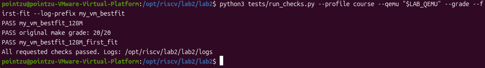

# Lab2 报告截图操作指南

本指南配合 [实验报告.md](实验报告.md)，保留重新操作时的命令和观察方法。2026-10-25 已将本人 VMware 的 8 张实际截图插入报告，文件和原图对应关系见 [images/README.md](images/README.md)。S06～S08 的 Sv39/TLB 证据引用成员一原始日志；下面的 S01～S08 是最初按主题安排的复现清单，不表示还欠固定数量的图片。报告实际另含 S09 的 Bare 调试两图。

有两种取证方式：重新运行后截取本机现场，或在终端展示仓库已有原始日志。后者必须在图注写明“原始日志复核”，不能称为本机新实测。S05～S08 已有成员一的完整调试日志，可先用日志方式补图；需要重新演示双 GDB 时再按后面的现场流程操作。

## 一 截图目录和基本操作

1. 在 Ubuntu 中打开更新后的仓库，进入 lab2 目录；后面的 Linux 命令均在该目录执行。通过终端输入 pwd，确认末尾为 /lab2。
2. 把 VMware 窗口和 Ubuntu 终端放大，保证命令、关键结果和配置名称可读。内容放不下时保留两张子图，按实际顺序放入报告。
3. 可按 Ctrl+Alt 将输入释放回 Windows，再用 Windows 截图工具区域截图，快捷键为 Win+Shift+S。保存为 PNG 到你 Windows 仓库的 lab2/images；也可用 Ubuntu 截图工具保存后复制回仓库。
4. 在报告使用普通 `` 图片语句，图片语句外不加代码围栏。本次报告中的 8 张图已按这种方式插入。

| 编号 | 文件名 | 必须能看见的内容 |
|---|---|---|
| S01 | S01_environment.png | 本次补图所在机器、代码提交、编译器与 QEMU 版本 |
| S02 | S02_bestfit_grade.png | 五函数检查、10/10 边界、Page Init 与 Best-Fit 的 20/20 |
| S03 | S03_buddy_tests.png | buddy_pmm_manager、Buddy T1～T6、独立 SLUB T1～T8、succeeded |
| S04 | S04_slub_bestfit.png | best_fit_pmm_manager、同一套独立 SLUB T1～T8、succeeded |
| S05 | S05_page_init_gdb.png | 初始化完成后的 nbase、npage、pages、sizeof(Page)、end、satp、根 PTE |
| S06 | S06_mmu_walk.png | 调用栈、访问 VA/类型、根表/PTE、叶项和翻译结果 |
| S07 | S07_tlb_miss_fill.png | 同次访问的旧 addr_code、缺失与填充 VA/PA |
| S08 | S08_tlb_hit.png | 同一页后续 addr_code 匹配及命中证据 |

若一组分成两张，可命名 S03_buddy_tests_a.png、S03_buddy_tests_b.png，并在报告连续插入两条图片语句。图注要写清配置、机器和属于现场还是历史日志。

## 二 S01 环境截图

进入 lab2，在你实际配置了课程环境的 Ubuntu 中执行：

```sh
pwd
git rev-parse --short HEAD
uname -a
riscv64-unknown-elf-gcc --version | head -n 1
command -v qemu-system-riscv64
```

成员三已验证的 QEMU 位于下面路径。仅当这台机器确实存在这个文件时使用：

```sh
export LAB_QEMU=/opt/ucore-manual/qemu-4.1.1/bin/qemu-system-riscv64
"$LAB_QEMU" --version | head -n 1
python3 --version
```

如果安装位置不同，把 LAB_QEMU 改为本机真实路径，并确认交叉编译器 bin 目录已经在 PATH。本机缺少工具时，S01 如实展示当前环境；S02～S08 可以使用已提交日志复核，不需要为一张补图伪造版本或输出。

图注示例：“图1 本次补图环境；原始成员三集成环境另见 member3_vm_environment.json。”只有同一台验证机的现场才能直接标作成员三原运行环境。

## 三 展示已提交的原始日志

这组命令只读取已提交文件，不重新启动内核。每组执行后截图，图注标明相应成员的原始日志复核。

### S02 评分和边界

```sh
printf '\n原始日志复核：成员三课程环境 Best-Fit 回归\n'
cat logs/member3_bestfit_128M_preserved.log
cat logs/member3_bestfit_128M_page_init_boundaries.log
cat logs/member3_bestfit_128M_grade.log
```

需要显示五个 PASS、10/10，以及 Page Init / Best-Fit 两项 OK、Total Score: 20/20。构建日志较长时可向下滚到最终结果，并用另一张子图保留检查结果。

### S03 Buddy 与独立 SLUB

```sh
printf '\n原始日志复核：成员三 VMware Buddy 集成\n'
sed -n '/memory management: buddy_pmm_manager/,$p' logs/member3_vm_buddy_qemu.log
```

应看到 Buddy 六项 PASS，T2 为 31924 pages，SLUB 八项 PASS，以及两条 member3_*_test() succeeded。不能把 T5 的 SKIP 当成 PASS；本次提交日志的 T5 确实为 PASS。

### S04 Best-Fit 下相同的独立 SLUB 测试

```sh
printf '\n原始日志复核：成员三 VMware Best-Fit 集成\n'
sed -n '/memory management: best_fit_pmm_manager/,$p' logs/member3_vm_best_fit_qemu.log
```

这里 T8 为 31925 pages，与 Buddy 的 31924 不同，原因是两种编译配置的内核末端不同。保持真实输出，不为统一数字而改日志。

### S05 初始化 GDB 日志

```sh
printf '\n原始日志复核：成员一内核 GDB，旧验证内核\n'
sed -n '/GUEST initialization complete/,$p' logs/os2026_guest_gdb.log
```

GDB 的 $1～$7 对应命令依次是 va_pa_offset、npage、nbase、pages、sizeof(Page)、end、satp；原命令见 debug/member1/generated_guest.gdb。日志模式下图注写“成员一旧验证内核初始化现场日志复核”，不要把其 pages 和根表地址当成新增 Buddy 的值。

### S06 页表查询

下面行段针对本仓库原样保留的 os2026_host_gdb.log：

```sh
printf '\n原始日志复核：成员一首条高地址指令的页表查询\n'
sed -n '123,170p' logs/os2026_host_gdb.log
```

要能看到 addr、base、i/levels/ptshift、idx、pte_addr、pte、ppn、翻译页基址及调用栈。输出较多可分为两张子图。图注保留“成员一旧内核”及 VA=0xffffffffc02000d8。

### S07 缺失与填充

```sh
printf '\n原始日志复核：成员一取指 TLB 缺失\n'
sed -n '92,102p' logs/os2026_host_gdb.log
printf '\n同次取指页的 TLB 填充\n'
sed -n '171,181p' logs/os2026_host_gdb.log
```

旧 addr_code 在日志中以无符号十进制全 1 显示；配合 VA 与安装的 vaddr/paddr 判定缺失到填充。显示格式不同不改变其数值。

### S08 后续命中

```sh
printf '\n原始日志复核：成员一同一取指页后续匹配\n'
sed -n '182,201p' logs/os2026_host_gdb.log
```

结合前一图比较同一页的 addr_code。图注写“原始日志中的后续查表匹配”，不把这条命令描述成重新执行了取指。

## 四 想重新运行 S02～S04 时

这部分在工具链和课程 QEMU 4.1.1 已可用的 Ubuntu 中执行。确认 LAB_QEMU 真实存在：

```sh
test -x "$LAB_QEMU" && "$LAB_QEMU" --version | head -n 1
python3 tests/run_checks.py --profile course --qemu "$LAB_QEMU" --grade --first-fit --log-prefix final_bestfit
python3 tests/run_member3_checks.py --qemu "$LAB_QEMU" --log-prefix final_integration
```

第一条 Python 命令通过后，用以下新日志替代第三节的旧文件进行截图：

```sh
cat logs/final_bestfit_128M_preserved.log
cat logs/final_bestfit_128M_page_init_boundaries.log
cat logs/final_bestfit_128M_grade.log
sed -n '/memory management: buddy_pmm_manager/,$p' logs/final_integration_buddy_qemu.log
sed -n '/memory management: best_fit_pmm_manager/,$p' logs/final_integration_best_fit_qemu.log
```

同时保留 final_bestfit_128M_environment.json、final_integration_environment.json、results.json 和 build.log。新页数若变化，按新 end 计算并说明，不能强行改成已有日志的数字。

成员三运行器固定使用课程 loader。如本机使用现代 QEMU/OpenSBI，原评分运行器可使用 --profile portable；独立测试需手动构建，所有命令使用一致配置：

```sh
make clean
make -j2 PMM=buddy MEMBER3_TESTS=1 PORTABLE_BOOT=1
make qemu PMM=buddy MEMBER3_TESTS=1 PORTABLE_BOOT=1 QEMU="$LAB_QEMU"
```

看到成功信息后，先按 Ctrl+A，松开后按 X 退出 QEMU。再 make clean，把两个命令中的 PMM=buddy 都换成 PMM=best_fit 重跑。此类截图应标明现代配置及其实际版本。

## 五 重新做 S05～S08 的双 GDB 现场

仅在有带源码调试符号的 QEMU 4.1.1 时采用本流程。普通发行版或 stripped 二进制可能不能观察 QEMU 内部变量；可先使用第三节的真实旧日志，或由成员一在原调试环境补图。

准备三个 Ubuntu 终端，全部进入同一份 lab2：A 为主机 GDB，调试 QEMU 进程；B 为 RISC-V GDB，调试客体内核；C 用来构建、查源码行和查看日志。主机 GDB 直接启动自己的 QEMU 子进程，避免附加到其他会话。

### 5.1 终端 C 生成调试内核

```sh
make clean
make -j2 PMM=best_fit MEMBER3_TESTS=0 PORTABLE_BOOT=0
```

这份构建的地址可能与开启独立测试的集成日志不同。后面按实际符号读取，不硬编码旧 kern_init、pages 或根表地址。

### 5.2 终端 A 由主机 GDB 启动 QEMU

每个终端的 shell 变量互不共享，先在 A 设置实际路径：

```sh
export LAB_QEMU=/opt/ucore-manual/qemu-4.1.1/bin/qemu-system-riscv64
gdb --args "$LAB_QEMU" -machine virt -m 128M -nographic -bios default -device loader,file=bin/ucore.img,addr=0x80200000 -S -gdb tcp:127.0.0.1:1235
```

在 A 的 `(gdb)` 提示符执行：

```gdb
set pagination off
set print frame-arguments all
handle SIGPIPE nostop noprint pass
set logging file logs/final_host_gdb.log
set logging overwrite off
set logging on
run
```

QEMU 因 -S 等待客体调试器，A 暂时没有新的 gdb 提示符是正常的。

### 5.3 终端 B 观察初始化完成后的变量 并截 S05

```sh
riscv64-unknown-elf-gdb bin/kernel
```

也可使用已配置的 gdb-multiarch。进入 B 的 `(gdb)` 后：

```gdb
set architecture riscv:rv64
set pagination off
set remotetimeout 120
set logging file logs/final_guest_gdb.log
set logging overwrite off
set logging on
target remote 127.0.0.1:1235
hbreak slub_init
continue
```

在 slub_init 入口暂停时，pmm_init 和页自检已经结束，对象层尚未开始分配，适合观察初始化结果。执行：

```gdb
bt
p/x va_pa_offset
p/x nbase
p/x npage
p/x pages
p sizeof(struct Page)
p/x &end
p/x $satp
x/gx (char *)&boot_page_table_sv39+511*8
set $pages_pa = (unsigned long long)pages - va_pa_offset
set $meta_bytes = (npage-nbase)*sizeof(struct Page)
set $free_pa = ($pages_pa+$meta_bytes+4095)&~4095ULL
p/x $free_pa
p ((npage<<12)-$free_pa)/4096
```

截取 S05。记录真实值，GDB 内不要手动把变量改成期望值。

### 5.4 从新进程开始捕获首次 TLB 缺失

S05 已经过很多取指，不能要求这时还能看到首次 miss。B 执行 detach、quit；A 按 Ctrl+C，执行 kill 并确认结束它自己启动的 QEMU，再设置断点并 run：

```gdb
break get_page_addr_code if addr >= 0xffffffffc0200000 && addr < 0xffffffffc0201000
break get_physical_address if addr >= 0xffffffffc0200000 && addr < 0xffffffffc0201000
break tlb_set_page_with_attrs if vaddr >= 0xffffffffc0200000 && vaddr < 0xffffffffc0201000
run
```

重新在 B 启动 RISC-V GDB、连接 1235，设置 hbreak *kern_init 后 continue。B 停在 kern_init 时，如 A 未停且需要继续执行，再在 B continue。A 一旦停住，先操作 A；主机停止时 B 可能等待远程回复，不要反复同时输入命令。

### 5.5 按实际命中位置采集 S06 S07 S08

| A 命中位置 | 操作和应观察的内容 |
|---|---|
| get_page_addr_code | 用 list 定位 entry 赋值完成、尚未判断 tlb_hit 的位置，逐步 next 到该行，打印 addr、mmu_idx、entry->addr_code |
| get_physical_address | 先 bt 6，确认调用来自 riscv_cpu_tlb_fill 的实际执行；若是 riscv_cpu_get_phys_page_debug，continue 查找执行路径 |
| tlb_set_page_with_attrs | 打印 vaddr、paddr、prot、mmu_idx 与调用栈，核对与刚才 miss 属于同一页 |
| 后续 get_page_addr_code | 到相同查表位置，打印实际 addr_code，观察匹配后的分支，或 next 确认不再走该次缺失填充路径 |

第一次查表时，在 entry 已赋值后保存真实观察值，供填充时同屏展示：

```gdb
p/x addr
p/x entry->addr_code
set $miss_addr = addr
set $miss_tag = entry->addr_code
continue
```

在 get_physical_address 的实际执行路径中：

```gdb
bt 6
p/x addr
p access_type
p mmu_idx
p/x env->satp
list
```

用 list 和 next 找到本机源码读取 pte、计算 ppn 之后的位置，再打印：

```gdb
p/x base
p i
p levels
p ptshift
p/x idx
p/x pte_addr
p/x pte
p/x ppn
set $physical_out = physical
```

继续单步观察叶项、权限、大页对齐和结果赋值；也可在记录上述值后 finish，在函数成功返回时 `p/x *$physical_out` 查看页基址。将页基址加实际 addr 的低 12 位得到完整 PA，截 S06。源码行号必须用本机 list 核对，不直接复制旧脚本的 256、337 或 1030。

到 tlb_set_page_with_attrs 时，可显示刚才保存的真实 miss 值，并截 S07：

```gdb
printf "MISS addr=%#lx old_tag=%#lx\n", $miss_addr, $miss_tag
p/x vaddr
p/x paddr
p prot
p mmu_idx
bt 6
continue
```

后续同页查询时，entry 赋值后 `p/x addr`、`p/x entry->addr_code`，配合实际分支单步或后续没有再次触发该页 fill 的路径，截 S08。不能只比较两个不相关地址；TCG 可能复用执行块，若没有再次命中这个 C 函数，可重新从新 QEMU 进程观察或使用已有日志复核，不能据断点没停就认定没有 TLB。

局部变量显示 optimized out 时，保留原始现象，可换合适的赋值后断点或使用已有带符号环境。不要把手工计算值贴到截图中冒充 GDB 可读值。完成后在 A/B 分别保存日志并正常退出本次调试会话。

## 六 图片放回报告

本次已将实际 PNG 放到 images，报告直接使用普通 Markdown 图片语句，例如：

```markdown

```

上面的代码块仅用于展示语法；报告中的图片语句本身没有围栏。新增截图时使用新的文件名，说明环境、构建参数、是现场还是原始日志复核，并同步修改 images/README.md。不能把其他配置的数值当作本次断点结果。
