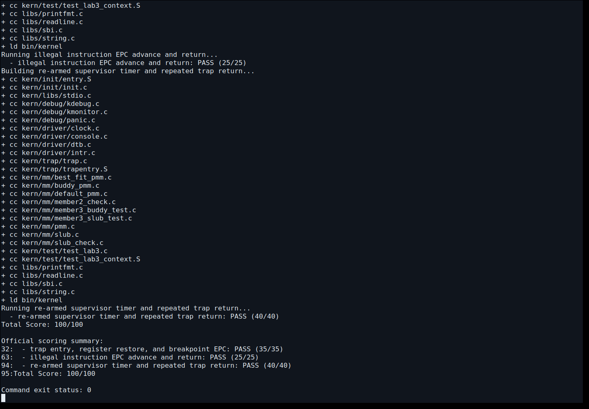
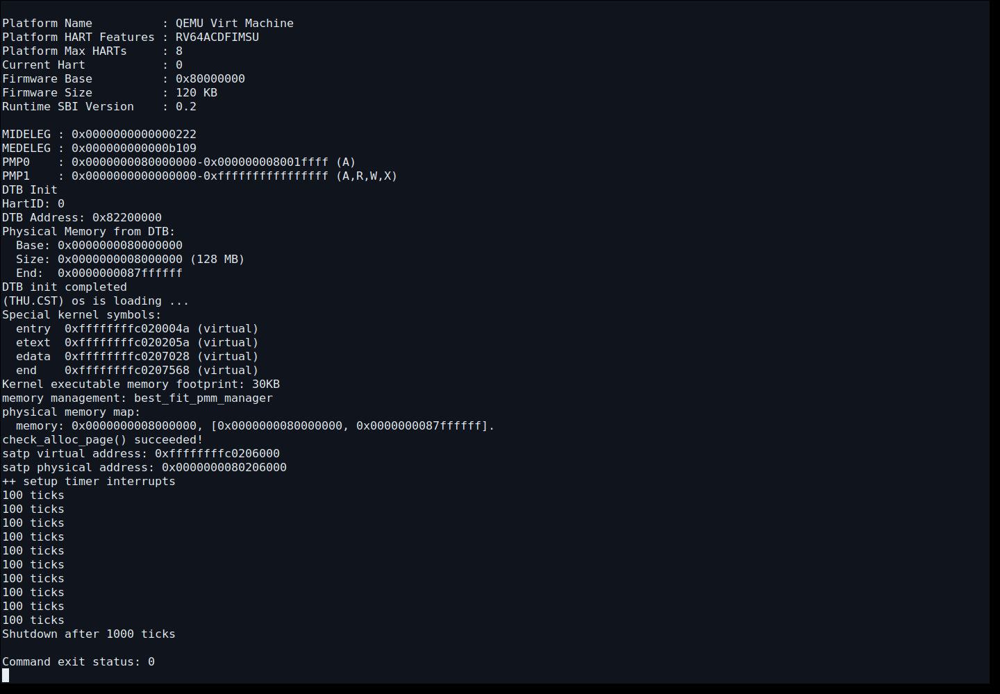
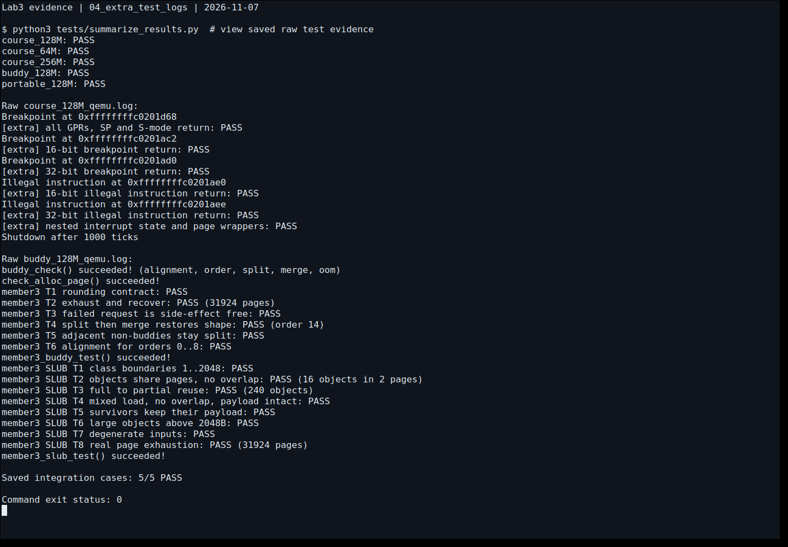
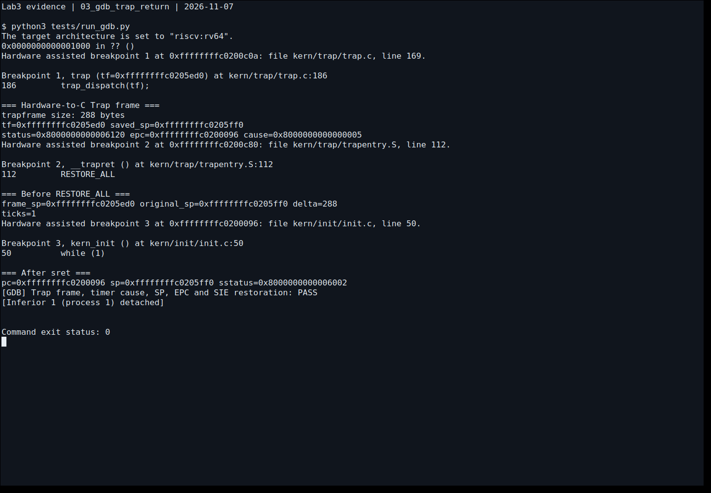

# Lab3 中断与异常处理实验报告

## 实验基本信息与完成范围

| 项目 | 内容 |
|---|---|
| 实验名称 | Lab3：断，都可以断——RISC-V 中断与异常处理 |
| 小组成员 | 石昊洋（2411804）、秦东杰（2411738）、邹俊轩（2412592） |
| 仓库 | [MonsterN58/10-OS2026](https://github.com/MonsterN58/10-OS2026) |
| 工程目录 | `labcodes/lab3` |
| 完成日期 | 2026-11-07 |
| AI 编程工具 | Codex 桌面应用，GPT-6；用于代码实现、测试、截图和报告整理 |
| 主要结果 | 官方评分 100/100；5 种集成配置通过；默认 1000 次时钟中断后正常关机 |

本报告沿用前两次报告的章节结构，参考 [Lab1 报告](https://github.com/MonsterN58/10-OS2026/blob/main/lab1/实验报告.md) 和 [Lab2 报告](https://github.com/MonsterN58/10-OS2026/blob/main/labcodes/lab2/实验报告.md)。Lab3 结果来自本轮编译运行。

Lab3 功能由三位成员共同交付，任务标记保留 `lab3 function1/function2`，并填写三位成员学号。Lab2 代码保留原有归属：石昊洋的 `page_init`、邹俊轩的 Best-Fit/SLUB 与 First-Fit 修复、秦东杰的 Buddy 与独立测试。

## 一、实验目的与整体逻辑

### 1.1 实验目的

1. 理解 RISC-V 中断、异常和 Trap 的区别，以及 M/S/U 特权级与固件的关系。
2. 理解硬件记录 CSR 与软件保存通用寄存器之间的分工。
3. 实现汇编入口到 C 语言处理函数，再恢复原执行流的完整闭环。
4. 处理时钟中断、非法指令异常、断点异常，验证系统可以重复返回。
5. 在页管理接口中保存和恢复中断状态，理解单 hart 临界区保护的范围。

### 1.2 本章的逻辑主线

Lab1 解决“内核如何开始执行”，Lab2 解决“哪些物理页可以分配、如何访问内存”，Lab3 进一步解决“内核被突发事件打断后怎样处理并继续执行”。因此，Lab3 依赖 Lab2 已有的内核栈、页表、直接映射和物理页管理。

本次实现顺序是：检查 Lab2 依赖与启动环境，迁入课程 Lab3 框架，补齐上下文恢复与汇编调用入口，再实现 C 层中断/异常处理，最后验证持续时钟、异常指令返回以及临界区状态恢复。

```text
OpenSBI → kern_entry → 建立启动页表、内核栈 → kern_init
  → 清 BSS → dtb_init → cons_init → print_kerninfo
  → idt_init：sscratch=0，stvec=__alltraps
  → pmm_init：沿用 Lab2 页管理与原始自检
  → slub_init：初始化已迁入的对象分配器
  → idt_init → clock_init → intr_enable → 内核空转

时钟/异常发生
  → 硬件记录 sepc/scause/stval，更新 sstatus，转入 stvec
  → __alltraps → SAVE_ALL，在当前内核栈构造 trapframe
  → a0=sp → trap(tf) → trap_dispatch(tf)
      → interrupt_handler(tf) 或 exception_handler(tf)
  → __trapret → RESTORE_ALL → sret → 原执行流
```

初始化中的两次 `idt_init()` 沿用课程框架，支持官方测试注入异常检查。实验执行于 S 模式，通过保存的 SPP 实现时钟中断的 S→S 返回。

## 二、基线、环境与证据来源

### 2.1 原始框架与 Lab2 迁移

原始框架下载自 [课程代码发布页](http://oslab.mobisys.top/lab2026/labcode.html) 中的 [lab3.zip](http://oslab.mobisys.top/lab2026/lab3.zip)。原件保存在 [reference/lab3_original.zip](reference/lab3_original.zip)，SHA256 为：

```text
b2328d813abf194e458cc4dab68815a1f9280e6ac73c9cfdcb4d60ec10f630bb
```

迁移基线为源仓库 Lab2 的 `ef63aa55c05bea863d2f4208f67cc14e0126d73f`。Lab3 使用独立目录，沿用 `page_init`、Best-Fit、First-Fit、Buddy、SLUB 与测试，以及启动页表、链接脚本和 portable 启动方式。

Lab3 的 `alloc_pages`、`free_pages`、`nr_free_pages` 使用课程框架的中断保护包装：保存 SIE 并关中断，调用分配器，再恢复原状态。

### 2.2 本轮环境

| 工具/配置 | 本轮实际值 |
|---|---|
| 操作系统 | Ubuntu 26.04.1 LTS，x86_64 |
| GNU Make | 4.4.1 |
| RISC-V GCC | `riscv64-unknown-elf-gcc` 14.2.0 |
| 课程 QEMU | 4.1.1，`/opt/ucore-manual/qemu-4.1.1/bin/qemu-system-riscv64` |
| 课程固件 | 串口输出为 OpenSBI v0.6 |
| 现代 QEMU | 10.2.1，`/usr/bin/qemu-system-riscv64` |
| GDB | `gdb-multiarch` 17.1 |
| 默认机器 | RISC-V `virt`，单 hart，128 MiB RAM |
| 补充内存配置 | 64 MiB、256 MiB |

环境摘要见 [environment.json](logs/environment.json)。课程配置使用 `-device loader`；现代 QEMU 使用 `PORTABLE_BOOT=1` 和 `-kernel`，保留 Lab2 低地址过渡同址映射。各配置在临时目录构建。

### 2.3 接口与代码的校验

[check_contracts.py](tests/check_contracts.py) 从原始压缩包提取基准，检查官方评分脚本、注入脚本、测试源码、`trap.h`、`SAVE_ALL`，以及 `trap.c` 中规定之外的七个函数保持原样。另按 Lab2 的既有摘要校验 `page_init` 和四个原始分配器测试。

本轮共 21 项契约检查通过，记录在 [contracts.log](logs/contracts.log)。检查期望来自原始包和 Lab2 清单。

## 三、功能模块一：Trap 上下文恢复与入口

### 3.1 功能规格（Spec）

文件为 [kern/trap/trapentry.S](kern/trap/trapentry.S)，待实现部分是 `RESTORE_ALL` 与 `__alltraps` 的调用段。完整规格见 [specs/lab3.md](specs/lab3.md)。

| 项目 | 约定 |
|---|---|
| 输入 | `SAVE_ALL` 在当前栈上构造的 `struct trapframe` |
| 中间接口 | `void trap(struct trapframe *tf)`，按 ABI 用 `a0` 传参 |
| 输出 | 恢复被打断程序的寄存器与返回 CSR，经 `sret` 继续执行 |
| 保留接口 | `SAVE_ALL`、`struct trapframe`、`trap()` 的函数签名 |
| 关键约束 | 恢复顺序与保存布局一致，`sp` 最后恢复，保留原特权级信息 |

### 3.2 Trap frame 布局

RV64 中 `uintptr_t` 为 8 字节，结构体包含 32 个通用寄存器槽和 4 个 CSR 槽，总计 `36×8=288` 字节。

| 字段 | 槽位 | 相对 frame 基址的字节偏移 |
|---|---|---|
| `gpr.x0…x31` | 0…31 | 0…248 |
| `gpr.sp` | 2 | 16 |
| `status` | 32 | 256 |
| `epc` | 33 | 264 |
| `badvaddr` | 34 | 272 |
| `cause` | 35 | 280 |

`SAVE_ALL` 通过 `sscratch` 保留原 `sp`，再分配 288 字节。槽 2 保存原栈指针，新 `sp` 指向帧基址。288 是 16 的整数倍，维持栈的 ABI 对齐。

### 3.3 核心实现

`__alltraps` 在 `SAVE_ALL` 后执行 `mv a0, sp`，将 frame 地址传给 `trap()`，随后 `jal trap`。C 函数返回后，栈指针应恢复到调用前的 frame 基址，接着进入 `__trapret`。

`RESTORE_ALL` 将槽 32、33 载入 `s0/s1` 并写回 `sstatus/sepc`，然后恢复通用寄存器。`x0` 恒为零，`scause/stval` 提供诊断信息。最后恢复槽 2 的 `sp`，此前的加载以帧地址为基址。

`sret` 根据 SPP 决定返回特权级，将 SPIE 恢复到 SIE，并从 `sepc` 继续执行。时钟中断保留 `epc`；异常处理需要跳过指令时，C 函数修改帧中的 `epc`。

### 3.4 最终提示词

完整工作提示词见 [01_trap_entry.md](prompts/01_trap_entry.md)，其组织方式为：

```text
[PROMPT]
根据已有 SAVE_ALL 和 trap.h 完成 RESTORE_ALL、__alltraps。

[RELY]
已有 36 槽 Trap frame、RISC-V ABI、trap(tf)、__trapret 与 sret。

[GUARANTEE]
保存的执行状态经 C 处理后恢复，支持 S→S 返回并保持原栈。

[SPECIFICATION]
a0=sp 后调用 trap；恢复 sstatus/sepc，再恢复 GPR，sp 最后恢复。
保留 SAVE_ALL、trapframe 布局和返回特权级。
用真实断点、寄存器快照、官方评分和 GDB 验证。
```

提示词明确布局、接口、恢复顺序和可观察结果，使生成代码遵循本项目的 Trap frame 偏移。

## 四、功能模块二：中断与异常处理

### 4.1 功能规格（Spec）

实现位于 [kern/trap/trap.c](kern/trap/trap.c) 的 `lab3 function2` 区域，接口为 `interrupt_handler(tf)` 与 `exception_handler(tf)`，其余函数和签名保持原样。

| 事件 | 行为 |
|---|---|
| S 模式时钟中断 | 重设下一事件、计数、定期输出、达到阈值后关机 |
| 其他已列出中断 | 依据框架 `IRQ_*` 宏分类，输出对应类型 |
| 未知中断 | 输出原因号并调用 `print_trapframe` |
| 非法指令异常 | 输出 `Illegal instruction at`，按指令长度推进 `epc` |
| 断点异常 | 输出 `Breakpoint at`，按指令长度推进 `epc` |
| 其他异常 | 使用原有 `print_trapframe` 兜底 |

### 4.2 中断分类与时钟处理

`trap_dispatch` 通过 `scause` 最高位区分中断和异常。`interrupt_handler` 清除标志位后按原因号分类；其他原因输出 `Unknown interrupt: cause N` 并打印现场。

对 `IRQ_S_TIMER`，每次先调用 `clock_set_next_event()` 预约下一次事件，再执行 `ticks++`。OpenSBI 每次安排一个事件，由处理程序持续预约。

`timebase=100000`，课程 QEMU 时间基准为 10 MHz，一次预约约在 10 ms 后触发。每当 `ticks % TICK_NUM == 0` 时调用 `print_ticks()`，输出 `100 ticks` 表示一组计数。

指导书要求达到 `SHUTDOWN_AFTER` 后关机。本实现使用 `#ifndef` 提供默认值 10，并支持编译时覆盖。第十组输出后调用 `sbi_shutdown()`，默认在 1000 次中断后退出；spec 记录了该配置。

运行间隔包含处理与重新预约的开销。

### 4.3 异常处理与 EPC 更新

非法指令与断点属于同步异常。实现读取 `tf->epc` 处的 16 位半字，在实验的 RV64GC 16/32 位编码范围内判断：低两位为 `00`、`01` 或 `10` 时长度为 2 字节，低两位为 `11` 时按 4 字节处理。输出信息后按长度推进 `epc`。

按指令长度推进地址，使压缩断点与 32 位非法指令分别回到下一条指令。补充测试使用 `.2byte 0x9002`、`.4byte 0x00100073`、`.2byte 0x0000`、`.4byte 0x0000007b`，分别触发两种长度的断点和非法指令，检查后续执行。

测试使用 `epc` 指向的可读内核代码，覆盖 16 位和 32 位编码。其他异常通过打印现场提供诊断信息。

### 4.4 最终提示词

完整输入见 [02_handlers.md](prompts/02_handlers.md)：

```text
[PROMPT]
在规定区域实现中断和异常分类处理，保留其他 trap.c 函数。

[RELY]
使用 tf->cause、tf->epc、IRQ/CAUSE 宏、clock_set_next_event、
ticks、print_ticks、print_trapframe 和框架的 sbi_shutdown。

[GUARANTEE]
时钟持续产生，每100次输出，达到组数阈值后关机；异常能跳过原指令返回。

[SPECIFICATION]
去除中断标志位后分类；未知类型输出现场。
按16/32位编码推进异常 epc；沿用官方测试验证结果。
对缺失的 SHUTDOWN_AFTER 定义显式记录假设并允许覆盖。
```

## 五、中断开关、原子性与 Lab2 接口

`intr_enable/disable` 操作 `sstatus.SIE`；`clock_init` 在 `sie` 中使能时钟来源。时钟中断由全局使能和来源使能共同控制。

`local_intr_save(flag)` 读取原 SIE，在原来开启时关闭；`local_intr_restore(flag)` 在保存值为真时重新开启。嵌套时外层保存 1、内层保存 0，内层退出保持关闭，外层退出恢复开启。

页接口采用该模式。补充测试在开启中断时进入两层保护区，分配并释放页，检查各层中断状态与空闲页数恢复。

`do { ... } while (0)` 让宏在语法上作为单条语句使用，支持 `if/else`；宏体执行一次。

本实验使用单 hart 配置，关中断管理本 hart 的中断状态；多 hart 共享数据可结合锁保护。

## 六、测试、调试与截图

### 6.1 官方评分

执行 `make grade`，使用原始 `tools/inject.py` 在临时副本注入官方测试，三组结果如下：

| 官方测试 | 结果 |
|---|---|
| Trap 入口、寄存器恢复、断点 EPC | 35/35 |
| 非法指令 EPC、软件/未知中断、异常兜底 | 25/25 |
| 时钟重新预约与重复 Trap 返回 | 40/40 |
| 合计 | **100/100** |

原始记录为 [grade.log](logs/grade.log)，截图时重新执行的记录为 [screenshot_grade.log](logs/screenshot_grade.log)。35、25、40 分对应表中的三组评分。



### 6.2 默认启动和正常关机

默认内核运行输出十行 `100 ticks` 和 `Shutdown after 1000 ticks`。QEMU 返回码为 0；初次运行约 10.22 秒，内核通过 SBI 发起关机。

记录见 [qemu_default.log](logs/qemu_default.log) 与 [screenshot_qemu.log](logs/screenshot_qemu.log)。截图命令的异常挂起上限为 25 秒，运行在上限内完成。



### 6.3 补充集成测试

[run_checks.py](tests/run_checks.py) 为每种配置建立临时目录并注入测试。所有配置检查页管理自检、十组时钟输出、1000 ticks 关机和 QEMU 退出。

| 配置 | 补充覆盖 | 结果 |
|---|---|---|
| 课程 QEMU，128 MiB，Best-Fit | 寄存器快照、四种异常编码、嵌套中断与页接口 | PASS |
| 课程 QEMU，64 MiB，Best-Fit | 同上，检验 64 MiB 下的内存发现和启动 | PASS |
| 课程 QEMU，256 MiB，Best-Fit | 内存发现、自检、持续时钟、关机 | PASS |
| 课程 QEMU，128 MiB，Buddy | 上述 Trap 检查，以及原 Buddy 6 组、SLUB 8 组测试 | PASS |
| QEMU 10.2.1，128 MiB，portable | 现代启动路径与上述 Trap 检查 | PASS |

结果见 [checks.json](logs/checks.json)，包含配置命令、返回码、运行时间和串口日志摘要。各配置日志文件名为 `logs/<配置名>_qemu.log`，符号地址对应各自配置。

额外汇编保存调用者的保存寄存器，给多数可写 GPR 装入模式值并触发断点，再将寄存器保存成快照逐项比较。`gp/tp` 保留原值并比较；`sp` 与快照基址比较，`x0` 检查恒零。

下图展示终端查看前述集成运行记录的截图。



### 6.4 GDB 观察真实 Trap 返回

通过 [run_gdb.py](tests/run_gdb.py) 启动暂停的默认内核，使用 [debug/trap.gdb](debug/trap.gdb) 在 `trap`、`__trapret` 和返回地址设置硬件断点，检查真实时钟中断：

```text
trapframe size: 288 bytes
tf=0xffffffffc0205ed0 saved_sp=0xffffffffc0205ff0
status=0x8000000000006120
epc=0xffffffffc0200096 cause=0x8000000000000005

frame_sp=0xffffffffc0205ed0 original_sp=0xffffffffc0205ff0 delta=288
ticks=1

After sret:
pc=0xffffffffc0200096 sp=0xffffffffc0205ff0
sstatus=0x8000000000006002
[GDB] Trap frame, timer cause, SP, EPC and SIE restoration: PASS
```

原因值最高位为 1、低位为 5，表明是 S 模式时钟中断。陷入后硬件清除了 SIE、把旧值保存在 SPIE；frame 中 SPP 为 1。返回后 SP 与原值相同，PC 回到原指令，SIE 恢复。SP 差值 288 同时印证汇编与 C 结构体布局一致。

这些地址来自本轮默认内核，后续增加代码或改变编译选项可能改变地址。原始记录见 [gdb_trap.log](logs/gdb_trap.log)。



### 6.5 截图如何产生

四张图片由 [capture_evidence.py](tests/capture_evidence.py) 在 Xvfb 显示器内启动 xterm 并读取帧缓冲得到。前三张分别执行评分、QEMU 和 GDB；第四张展示已保存日志。

## 七、AI 实现与验证中实际遇到的问题

### 7.1 CSR 名称兼容

构建官方包时，汇编器报告 CSR 名称兼容问题，并提示处理函数声明。[原始记录](logs/upstream_baseline_build.log) 保存了构建过程。

在 `riscv.h` 的汇编预处理分支增加 `sbadaddr → stval` 别名，二者指向 CSR 0x143；随后补齐处理函数。契约检查确认保存宏与官方包一致。

### 7.2 指导书提到的关机阈值在原始包中缺失

指导书要求使用 `SHUTDOWN_AFTER`。实现给出默认十组，并支持编译时覆盖；spec 和报告记录该选择。评分后另行运行关机用例，验证计时和关机流程。

### 7.3 AI 编写的补充测试出现同名对象冲突

补充测试曾使用 `trap_probe.c` 与 `trap_probe.S`，构建规则将二者映射到 `trap_probe.o`。[构建记录](logs/initial_probe_build_failure.log)保存了处理过程。

将汇编文件更名为 `trap_probe_registers.S`，使两份源码生成各自目标文件，然后重新执行集成测试。

### 7.4 GDB 脚本的地址类型处理

GDB 脚本计算保存的 SP 与 `$sp` 的差值时，使用显式类型转换适配 GDB 运算规则。

将 `$sp` 转换为 `unsigned long` 后重新运行，完成返回地址、栈指针和 SIE 核对。处理过程见 [initial_gdb_script_failure.log](logs/initial_gdb_script_failure.log)，结果见最终 GDB 日志。

### 7.5 截图自动化中的前台终端问题

终端运行采用 `timeout --foreground` 保持前台行为，随后记录启动、十组计时与关机过程；截图展示该次运行。前期记录见 [initial_capture_timeout.log](logs/initial_capture_timeout.log)。

任务标记检查聚焦 `lab2/lab3` 任务占位行，并保留说明与作者信息。

实现过程明确了工程命名规则、工具接口和验证方式。核心实现首次官方评分通过，补充验证工具经调整后完成检查。

## 八、重要知识点与 OS 原理的对应

| 实验知识点 | 对应原理 | 联系与差异 |
|---|---|---|
| RISC-V Trap | 中断、异常、控制流转移 | 本架构将异步中断和同步异常统称 Trap |
| `stvec` Direct 模式 | 中断入口与分发 | 事件先进入汇编入口，再由 C 分类 |
| `sepc/scause/stval` | 硬件异常现场 | 硬件提供原因和位置，汇编保存通用寄存器 |
| `trapframe` | 上下文保存与恢复 | 记录一次陷入的现场，并与进程调度状态协作 |
| `a0=sp` 调用 `trap` | 汇编与 C 的 ABI 边界 | 同时满足数据布局和参数约定，C 才能正确解释保存的现场 |
| `SIE/SPIE/SPP` 与 `sret` | 特权级与中断状态恢复 | 应按保存状态返回；S 模式陷入也可能返回 S 模式 |
| 指令长度与 `epc` | 异常恢复语义 | 跳过已处理异常需识别指令长度；时钟中断则保留返回位置 |
| OpenSBI 定时器 | 硬件抽象与周期事件 | 每次设置产生一个事件，软件重新预约形成连续计时 |
| 关中断保护页接口 | 临界区、原子性 | 管理本 hart 的中断状态，多核共享可结合锁保护 |
| 嵌套保存与恢复 | 可组合的同步接口 | 根据进入前的状态恢复，支持嵌套临界区 |

### OS 原理中的相关知识点

1. **用户进程与系统调用。** 用户地址空间、系统调用分发表、参数校验和用户栈到内核栈切换构成用户进程的运行机制。
2. **抢占式调度。** 周期时钟提供调度时机，就绪队列、时间片与进程切换共同支持调度。
3. **缺页与虚拟内存恢复。** 页表建立、调页、置换和写时复制构成虚拟内存管理机制。
4. **设备中断。** PLIC 的 claim/complete、设备队列和驱动处理共同完成设备服务。
5. **多核同步。** 自旋锁、跨 hart 内存序协议、多核 TLB shootdown 和每 CPU 数据支持多核协作。
6. **嵌套异常与扩展状态。** 双重异常处理与浮点、向量寄存器管理拓展上下文机制。

## 九、实验总结与复核入口

实验连接硬件记录原因与跳转、软件保存寄存器与调用处理函数的过程。Trap frame 布局、调用约定和返回状态共同支撑执行流恢复。

AI 协作时，提示词给出接口和约束，QEMU、GDB 与评分记录展示各项输出。测试覆盖本报告列出的单 hart 配置与用例。

### 复跑命令

```sh
cd labcodes/lab3
export PATH=/opt/ucore-manual/qemu-4.1.1/bin:$PATH

python3 tests/check_contracts.py
make grade
make -j4
make qemu
python3 tests/run_checks.py
python3 tests/run_gdb.py
```

切换 `PMM`、`PORTABLE_BOOT` 或其他编译宏前先 `make clean`。额外测试脚本已使用独立副本；直接手动构建时仍需遵守这一点。

| 交付内容 | 入口 |
|---|---|
| 功能规格 | [specs/lab3.md](specs/lab3.md) |
| Lab2 迁移与测试工作提示词 | [00_migration_and_validation.md](prompts/00_migration_and_validation.md) |
| 两个练习提示词 | [入口与恢复](prompts/01_trap_entry.md)、[中断与异常](prompts/02_handlers.md) |
| 新增核心代码 | [trapentry.S](kern/trap/trapentry.S)、[trap.c](kern/trap/trap.c) |
| 原始代码包与清单 | [reference](reference/lab3_original.zip)、[upstream_manifest.json](specs/upstream_manifest.json) |
| 评分、运行与调试证据 | [logs](logs/)、[screenshots](screenshots/) |
| 使用说明 | [README.md](README.md) |

本次交付包括 GitHub 仓库中的代码、报告、日志和截图。课程平台提交可按课程要求办理。

## 十、指导书阅读范围

本次阅读了 Lab3 目录全部 12 个 HTML 页面，以及中断处理页的两张 `scause` 图片。目录中的 `Page_table.drawio` 是页表图。各页依据如下：

- [实验介绍](http://oslab.mobisys.top/lab2026/_book/lab3/lab3.html)、[实验目的](http://oslab.mobisys.top/lab2026/_book/lab3/lab3_1_goals.html)、[实验内容](http://oslab.mobisys.top/lab2026/_book/lab3/lab3_2_labs.html)。
- [练习要求](http://oslab.mobisys.top/lab2026/_book/lab3/lab3_2_1_exercise.html)、[项目组成与执行流](http://oslab.mobisys.top/lab2026/_book/lab3/lab3_2_2_files.html)。
- [中断处理章节入口](http://oslab.mobisys.top/lab2026/_book/lab3/lab3_3_interrupt.html)、[RISC-V 中断介绍](http://oslab.mobisys.top/lab2026/_book/lab3/lab3_3_1_introduce.html)。
- [汇编入口](http://oslab.mobisys.top/lab2026/_book/lab3/lab3_3_2_trapentry.html)、[C 层处理](http://oslab.mobisys.top/lab2026/_book/lab3/lab3_3_3_trap.html)。
- [时钟中断](http://oslab.mobisys.top/lab2026/_book/lab3/lab3_3_4_clock.html)、[中断开关](http://oslab.mobisys.top/lab2026/_book/lab3/lab3_3_5_atomic.html)、[报告与提交要求](http://oslab.mobisys.top/lab2026/_book/lab3/lab3_4_lab_requirement.html)。
